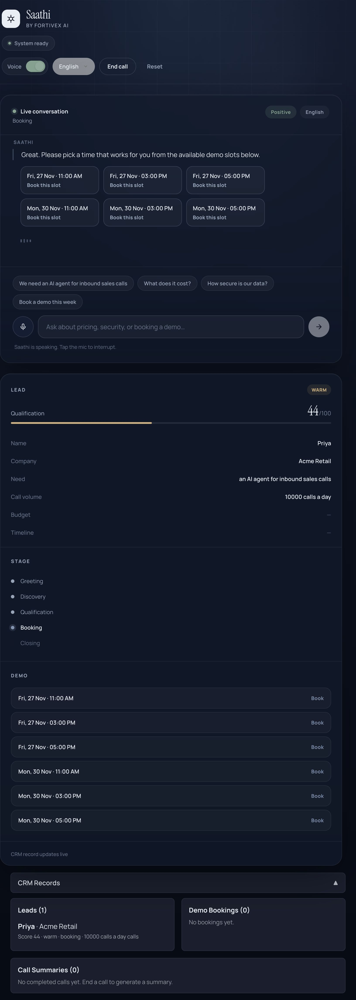
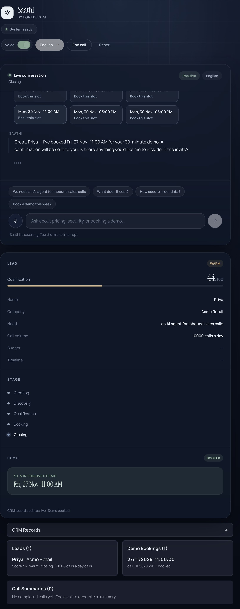
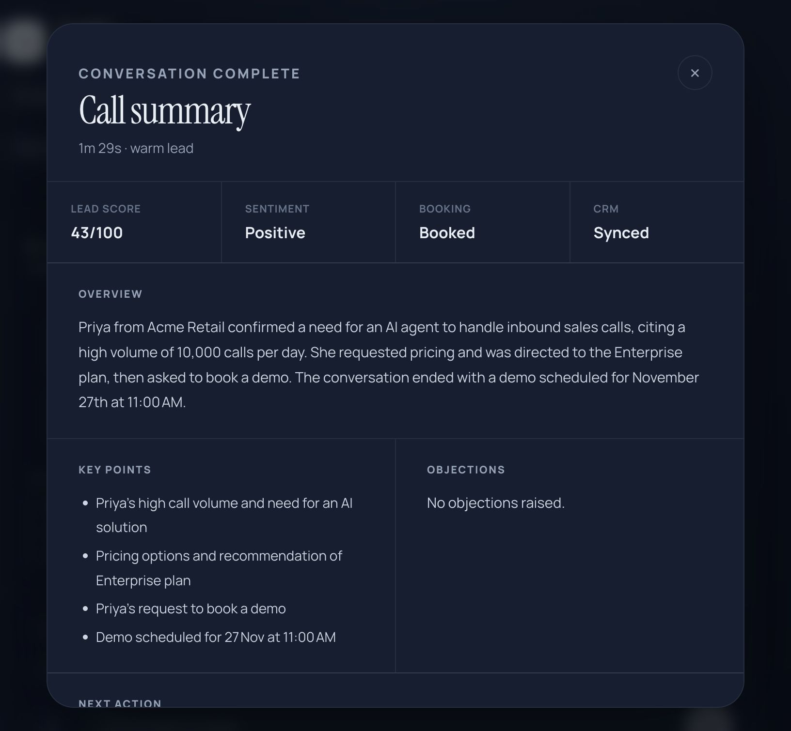
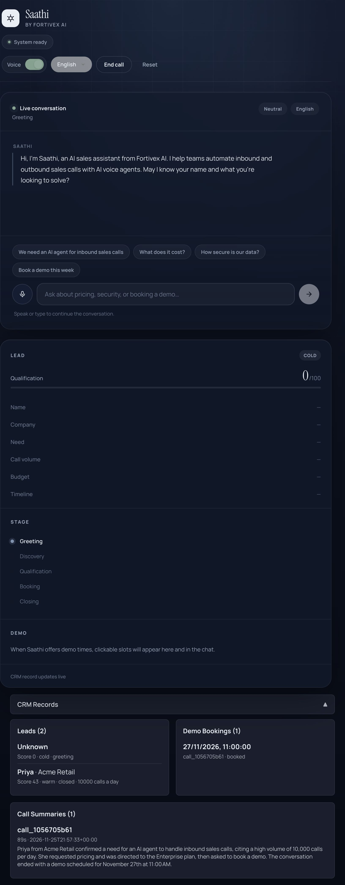

# Saathi — A Companion for Business Conversations

Voice-first autonomous sales agent for Fortivex AI. Answers from a knowledge base, qualifies leads, books demos, updates CRM, and generates call summaries. Runs locally with free/open-source software; Groq and neural TTS are optional upgrades.

    

## Quick start

```bash
ollama pull llama3.2:3b
ollama pull nomic-embed-text

make setup
make backend     # terminal 1 → :8000
make frontend    # terminal 2 → :5173
```

Open **http://localhost:5173**. Optional: `make setup-voice && make voice` for local Kokoro TTS, and put a Groq key in `backend/.env` (gitignored) for stronger replies.

## What it does

**Inbound call → grounded answer → qualification → booking → CRM update → call summary.**

- **Voice:** browser Web Speech STT + Kokoro-82M TTS (browser fallback), with streaming sentence-by-speech.
- **RAG:** 10 Markdown docs, local embeddings, keyword fallback; answers grounded in sources, out-of-scope gets a safe boundary reply.
- **Memory:** lead profile persists across turns (name, company, need, budget, timeline, role, call volume) — never re-asks known facts.
- **Booking:** asks identity first, shows clickable slots only when relevant, books once, stores in CRM.
- **CRM Records:** live in-page list of leads, demo bookings, and call summaries.
- **Languages:** English and Hindi.

## Interface

Live booking flow — clickable slot chips appear only after a booking request:



Booking confirmed — Lead panel and CRM Records update instantly:



End-of-call summary modal:



Stored CRM records — leads, bookings, and call summaries:



## Stack

| Layer | Tech |
|---|---|
| Frontend | React 18, Vite 6, Web Speech API, plain CSS |
| Backend | Python 3.10+, FastAPI, Uvicorn, Pydantic, httpx |
| LLM | Ollama `llama3.2:3b` (local), optional Groq `openai/gpt-oss-20b` |
| Retrieval | `nomic-embed-text` embeddings, NumPy cosine, keyword fallback |
| Voice | Kokoro-82M local TTS at `:8100`, browser speech fallback |
| Data | SQLite (leads, appointments, calls, turn analytics) |
| Tests | pytest |

## Verified

```bash
cd backend && .venv/bin/python -m pytest -q   # 24 passed
cd frontend && npm run build                  # passed
```

End-to-end checked via `/api/chat`, `/api/chat/stream`, and the browser: grounded pricing, call-volume memory, English-only replies, identity-gated booking, slot click → booking → CRM, summary modal, and Hindi mode.

## More

- [`docs/architecture.md`](docs/architecture.md) — diagrams, scaling to 1,00,000 users, security, deployment
- [`PROJECT_REPORT.md`](PROJECT_REPORT.md) — business problem, feasibility, costs
- [`docs/demo-script.md`](docs/demo-script.md) — 5-minute demo script
- [`docs/interview-prep.md`](docs/interview-prep.md) — Q&A and live-coding tasks
- [`backend/.env.example`](backend/.env.example) — full config reference

## License

MIT — see [`LICENSE`](LICENSE).
