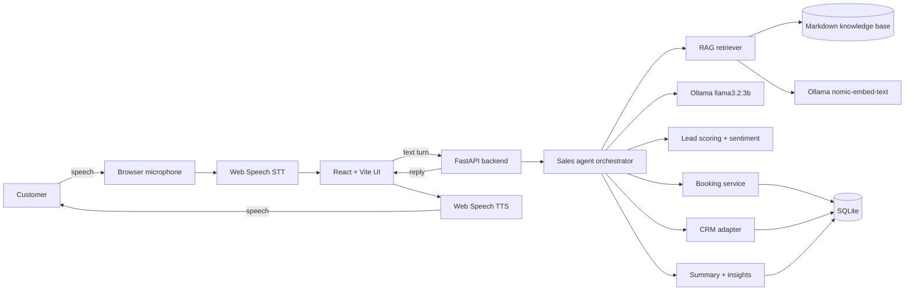

# Mira — Autonomous AI Sales Voice Agent

**Mira** is the assistant persona: a warm, concise, multilingual sales development representative for Fortivex AI. She runs the full first-line sales conversation locally, with no paid APIs.

A working, end-to-end MVP of an autonomous AI sales voice agent built entirely with free and open-source software. The agent holds a real-time voice conversation, answers questions from a company knowledge base with RAG, qualifies the lead, tracks sentiment, books a demo, writes to a CRM-style store, and produces a post-call summary with business insights.

Built for the **Fortivex AI — Round 3 Advanced AI Project Challenge**.

   -34d399)

---

## 1. What the demo proves

One complete business workflow runs live:

> **Inbound call → grounded product answer → qualification → objection handling → sentiment tracking → appointment booking → CRM update → call summary and insights.**

| Requirement | How this MVP implements it |
|---|---|
| Real-time STT / TTS | Browser `SpeechRecognition` + `SpeechSynthesis` (free). Text input works as a fallback. Whisper + Piper is the documented local production path. |
| Contextual memory | In-process session history plus a structured lead profile persisted in SQLite. |
| Multilingual | English and Hindi: language selector, multilingual prompt, Hindi query expansion for retrieval, and Hindi TTS voice selection. |
| Lead qualification | LLM extraction plus deterministic regex extraction of name, company, need, budget, timeline, role and contact details. Explainable 0–100 score → Hot / Warm / Cold. |
| Sentiment analysis | LLM sentiment label combined with a transparent lexicon fallback; per-turn scores drive a sentiment trend. |
| RAG | Markdown knowledge base chunked by heading, embedded locally with `nomic-embed-text` through Ollama, cosine search with keyword fallback and intent-aware source boosting. |
| Appointment booking | Live slot generation (next weekdays), double-booking protection, and booking through either conversation or a UI button. |
| CRM integration | SQLite-backed CRM adapter: lead upsert, score, stage, sentiment, booking and sync timestamp. Designed to swap in HubSpot/Salesforce. |
| Call summarisation | Structured summary: executive summary, need, discussion points, objections, sentiment trend, next action and follow-up. |
| Business insights | Aggregate funnel and sentiment metrics from stored calls. |

## 2. Architecture



Full design, scaling plan and failure modes: [`docs/architecture.md`](docs/architecture.md).

## 3. Quickstart (100% local, no API keys)

### Prerequisites

- Python 3.10+
- Node.js 18+
- [Ollama](https://ollama.com/) running locally
- ~3 GB free disk for models

```bash
ollama pull llama3.2:3b
ollama pull nomic-embed-text   # optional; keyword RAG fallback works without it
```

### One-command dev setup

```bash
make setup     # creates backend/.venv, installs Python + npm deps
make backend   # terminal 1: FastAPI on :8000
make frontend  # terminal 2: Vite on :5173
```

Or manually:

```bash
# Backend
cd backend
python3 -m venv .venv
source .venv/bin/activate
pip install -r requirements.txt
cp .env.example .env
uvicorn app.main:app --reload --port 8000

# Frontend (new terminal)
cd frontend
npm install
npm run dev
```

Open **http://localhost:5173**. API docs are at **http://localhost:8000/docs**.

### Verify without a browser

```bash
make test    # 13 unit tests
make demo    # scripted English call against a running backend
backend/.venv/bin/python scripts/demo_call.py --language hi-IN
```

## 4. Demo flow

1. Click **Start call**. Mira greets you by voice.
2. Say: *“Hi, I’m Priya from Acme Retail. We need an AI agent to handle inbound sales calls.”*
3. Ask: *“What does it cost?”* — the answer is retrieved from `data/knowledge/03-pricing.md`.
4. Say: *“We have a budget of around $2,000 per month and want to launch in 3 weeks. I’m the head of sales.”* — the lead score jumps to Hot and the stage advances.
5. Say: *“Yes, book the first slot.”* — the slot is booked, the CRM panel updates, and a confirmation is spoken.
6. Click **End call** — the summary modal shows the executive summary, objections, sentiment trend and next action.

Hindi: switch the language selector to **हिन्दी** and repeat the same flow.

A presenter-ready script with expected outputs: [`docs/demo-script.md`](docs/demo-script.md).


## 5. Repository layout

```text
.
├── README.md
├── PROJECT_REPORT.md              # mandatory 1-page report
├── LICENSE
├── Makefile
├── docs/
│   ├── architecture.md            # diagrams, scaling, security, failure modes
│   ├── demo-script.md             # 5-minute live demo script
│   └── interview-prep.md          # likely questions + live-coding tasks
├── data/knowledge/                # 8 RAG source documents (EN + Hindi glossary)
├── scripts/
│   ├── demo_call.py               # scripted end-to-end API call
│   └── dev.sh                     # starts backend + frontend
├── backend/
│   ├── requirements.txt
│   ├── requirements-dev.txt
│   ├── .env.example
│   ├── tests/test_core.py
│   └── app/
│       ├── main.py                # FastAPI routes
│       ├── agent.py               # orchestration, prompt, scoring, booking, summary
│       ├── rag.py                 # chunking, embeddings, keyword fallback
│       ├── llm.py                 # Ollama client + JSON repair
│       ├── db.py                  # SQLite schema + CRM store
│       ├── slots.py               # slot generation and availability
│       ├── schemas.py             # Pydantic request models
│       └── config.py              # environment configuration
└── frontend/
    └── src/
        ├── App.jsx
        ├── components/            # Header, Transcript, Composer, LeadPanel, SummaryPanel
        ├── hooks/                 # STT + TTS hooks
        └── styles.css
```

## 6. API

| Method | Path | Purpose |
|---|---|---|
| `GET` | `/api/health` | Model, RAG mode and session status |
| `POST` | `/api/session` | Start a call, returns greeting |
| `POST` | `/api/chat` | Send a turn; returns reply, lead, score, sentiment, stage, sources, booking |
| `POST` | `/api/session/{id}/book` | Book a specific slot from the UI |
| `POST` | `/api/session/{id}/end` | End call and generate summary |
| `GET` | `/api/leads` | CRM-style lead list |
| `GET` | `/api/appointments` | Booked appointments |
| `GET` | `/api/insights` | Aggregate business insights |
| `POST` | `/api/demo/reset` | Clear demo data (guarded by `ALLOW_DEMO_RESET`) |

## 7. Configuration

| Variable | Default | Purpose |
|---|---|---|
| `OLLAMA_BASE_URL` | `http://localhost:11434` | Ollama endpoint |
| `OLLAMA_MODEL` | `llama3.2:3b` | Chat model |
| `OLLAMA_EMBED_MODEL` | `nomic-embed-text` | Embedding model |
| `USE_EMBEDDINGS` | `true` | Falls back to keyword search automatically |
| `DB_PATH` | `backend/data/sales_agent.db` | SQLite database |
| `KNOWLEDGE_DIR` | `data/knowledge` | RAG documents |
| `CORS_ORIGINS` | `http://localhost:5173` | Allowed frontend origins |
| `ALLOW_DEMO_RESET` | `true` | Enables the reset endpoint |

## 8. Design decisions and honest limitations

- **Local-first:** no paid API keys and no cloud dependency for reasoning. The same code can point at a hosted OpenAI-compatible endpoint in production.
- **Deterministic guardrails around a small model:** structured JSON prompting, JSON repair, deterministic lead extraction, scripted fallback, and explicit slot buttons make the demo reliable on a 3B model.
- **Browser speech is not fully local.** Chrome’s Web Speech STT may use a vendor cloud service. For a privacy-critical deployment, replace it with self-hosted Whisper (STT) and Piper (TTS); the UI already isolates speech behind hooks.
- **SQLite and in-memory sessions are MVP choices**, not production choices. The scaling path is Postgres + Redis + a queue, documented in the architecture.
- **CRM and calendar are adapters**, currently backed by SQLite. HubSpot/Salesforce/Calendly adapters are the production extension point.

## 9. Tests

```bash
cd backend && .venv/bin/python -m pytest -q
```

Covers lead scoring, placeholder filtering, affirmative detection, JSON repair, keyword RAG in English and Hindi, slot uniqueness, and double-booking protection.

## 10. Business case

See [`PROJECT_REPORT.md`](PROJECT_REPORT.md) for the 1-page report covering the business problem, implementation, commercial feasibility, scaling to 1,00,000 users, data security, infrastructure, deployment and operating costs.

## License

MIT — see [`LICENSE`](LICENSE).
