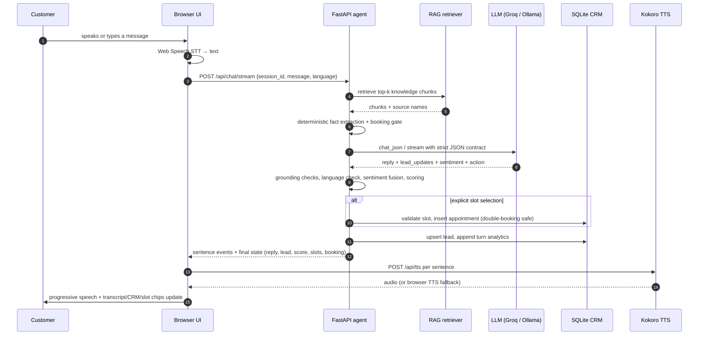
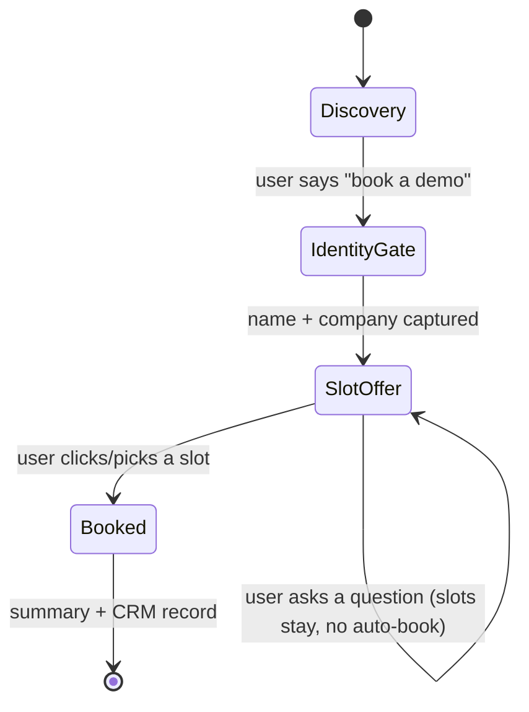

# Saathi — A Companion for Business Conversations

**Saathi** (Hindi for *companion*) is Fortivex AI's first-line autonomous sales voice agent. She holds a natural, real-time conversation, answers from an approved knowledge base, qualifies the lead, books a demo, writes to a CRM store, and produces a post-call summary with business insights.

Built for the **Fortivex AI — Round 3 Advanced AI Project Challenge**. The MVP runs on a laptop with free/open-source software; an optional Groq API key and an optional local neural voice service improve quality without changing the agent contract.

     

---

## 1. The business problem

Inbound sales teams lose leads in the first few minutes: enquiries arrive after hours, qualification varies by rep, product answers are inconsistent, and CRM notes are incomplete. Hiring linearly does not scale. The business needs a 24/7 first-line seller that answers accurately, qualifies consistently, books meetings, and hands a clean record to a human.

Saathi is the working answer to that problem: a voice-first agent that completes the entire loop from **first hello → grounded answer → qualification → booked demo → CRM record → call summary**.

## 2. What the MVP proves

One complete business workflow runs live:

> **Inbound call → grounded product answer → qualification → objection handling → sentiment tracking → appointment booking → CRM update → call summary and insights.**

| Challenge requirement | How this MVP implements it |
|---|---|
| Real-time voice interaction | Browser `SpeechRecognition` (STT) + local **Kokoro-82M** neural TTS through `/api/tts`, with browser `speechSynthesis` as fallback. `/api/chat/stream` emits sentence events so speech starts while the answer is still being produced. |
| Contextual memory | In-process session history plus a structured lead profile persisted in SQLite: name, company, need, budget, timeline, role, contact, **call volume**, stage, sentiment. The agent never re-asks for facts already captured. |
| Multilingual communication | English and Hindi: language selector, Hindi-system prompt, Hindi query expansion for retrieval, and Hindi-aware TTS voice selection. |
| Intelligent lead qualification | LLM extraction **plus** deterministic regex extraction of explicit facts. Explainable 0–100 score → Hot / Warm / Cold. |
| Sentiment analysis | LLM sentiment label fused with a transparent lexicon; per-turn scores drive sentiment trend and scoring. |
| RAG-based knowledge retrieval | 10 Markdown documents chunked by heading, embedded locally with `nomic-embed-text`, cosine search with keyword fallback, intent-aware source boosting, and deterministic grounded handlers for key facts. |
| Automated appointment booking | Live weekday slots, **identity gate before showing slots**, clickable slot chips in chat, double-booking protection, booking via chat click or API. |
| CRM integration | SQLite-backed CRM adapter: lead upsert, score, stage, sentiment, booking, sync timestamp. The **Lead** panel and **CRM Records** panel show live state in the page. Adapters are designed to swap in HubSpot/Salesforce. |
| Call summarisation | Structured summary: executive summary, need, discussion points, objections, sentiment trend, next action, follow-up. |
| Business insights | Aggregate funnel and sentiment metrics from stored calls. |

### Behavior guarantees (things the agent deliberately does *not* do)

- **No premature booking** — "book a demo" never books a slot; it first asks for name + company, then offers slots.
- **No slots unless relevant** — available slots appear only during the booking flow, not on every message.
- **No repeat "booked" toast** — the confirmation is shown once, when the booking actually happens.
- **No language drift** — Devanagari text is rejected in English replies; the agent stays in the selected language.
- **No glossary leakage or guessed answers** — example-phrase lists from the Hindi glossary are filtered out of generated replies; out-of-scope questions get a safe KB-boundary answer.
- **No stream/final mismatch** — bad or partial model output is discarded before the final state is emitted; spoken text and transcript stay identical.

## 3. Tech stack

| Layer | Technology | Version | Role in the project |
|---|---|---|---|
| **Frontend** | React | 18.3 | Component-based UI (transcript, composer, panels, summary) |
| | Vite | 6.x | Dev server and production bundler |
| | Web Speech API | browser | `SpeechRecognition` STT, `speechSynthesis` fallback TTS |
| | CSS | plain | Dark-navy SaaS identity, cinematic intro, responsive workspace |
| **Backend** | Python | 3.10+ | Agent orchestration and business logic |
| | FastAPI | 0.115+ | REST routes, SSE-style streaming chat |
| | Uvicorn | 0.30+ | ASGI server |
| | Pydantic | 2.9+ | Request/response validation |
| | httpx | 0.27+ | Calls to Ollama, Groq, and local TTS |
| **LLM** | Ollama + `llama3.2:3b` | local | Default/free reasoning and chat fallback |
| | Groq OpenAI-compatible API | optional | `openai/gpt-oss-20b` for stronger JSON compliance and replies |
| | JSON repair + retry | custom | Tolerates fences, trailing commas, prose around JSON |
| **Embeddings** | Ollama + `nomic-embed-text` | local | RAG vectors; keyword fallback if unavailable |
| **RAG** | Markdown + NumPy cosine similarity | 1.26+ | Chunking, retrieval, Hindi/English synonym expansion |
| **Voice** | Kokoro-82M (`kokoro` 0.9.2) | local, Apache-2.0 | 82M-parameter neural TTS at 24 kHz, CPU-capable |
| | soundfile / spaCy `en_core_web_sm` | — | Audio encoding and text normalisation |
| **Persistence** | SQLite | stdlib | Leads, appointments, calls, turn analytics |
| **Testing** | pytest | 8.x | 24 unit/regression tests |
| **Tooling** | Makefile, `uv` (voice env only), Git | — | Setup, run, test, demo commands |

## 4. End-to-end workflow

### 4.1 Turn lifecycle



### 4.2 Complete example conversation (verified flow)

| # | Customer | Saathi | State change |
|---|---|---|---|
| 1 | "We need an AI agent for inbound sales calls" | "Hi! I'm Saathi from Fortivex AI. Could you share your name, company, and how many inbound sales calls you receive weekly?" | `need` captured, stage → discovery, **no slots** |
| 2 | "my name is vishnu" | "Nice to meet you, Vishnu! How many inbound sales calls do you handle each month?" | `name = Vishnu`, no booking, no slots |
| 3 | "Acme Retail" | "Nice to meet you, Vishnu! I see you're from Acme Retail. How many calls do you handle monthly?" | `company = Acme Retail` |
| 4 | "around 500 per month" | "Thanks, Vishnu! 500 inbound calls a month is great to start. What budget do you have in mind?" | `call_volume = around 500 per month` |
| 5 | "What does it cost?" | "Starter at $199/month… Growth at $499/month… Enterprise custom…" (from `03-pricing.md`) | grounded pricing, source chip shown |
| 6 | "Book a demo" | "Before I book that, may I have your name and company name?" | `pending_booking = true`, no booking |
| 7 | "My name is Vishnu, I work at Acme" | "Great. Please pick a time that works for you from the available demo slots below." | 4 clickable slot chips appear |
| 8 | *clicks a slot chip* | "Great, Vishnu — I've booked Fri, 27 Nov · 11:00 AM for your 30-minute demo…" | booking written, CRM updated, toast once, chips hidden |
| 9 | *End conversation* | Summary modal + insights | call summary stored, CRM Records refreshed |

Hindi works through the same flow when the selector is set to **हिन्दी**.

### 4.3 Booking state machine



The slot is validated again at write time and a unique constraint on slot time prevents double booking.

### 4.4 Grounding and safety rules

1. Every factual answer (pricing, security, product, integrations, onboarding, comparison) has a deterministic KB-grounded handler, so a small or unstable model cannot invent numbers.
2. Replies are checked for empty/echoed text, hallucinated placeholders, wrong pricing, Devanagari in English replies, and glossary-style example lists. Failing replies are replaced by grounded fallbacks before streaming or display.
3. If the external provider fails, the request is retried and then routed to local Ollama; if that also fails, deterministic grounded handlers keep the conversation usable.
4. Out-of-scope questions get a bounded answer: "I can help with Fortivex AI product, pricing, security, integrations, and demo booking…" — no guessing.
5. Short contextual numbers (e.g. "10000", "around 500 per month") are interpreted in sales context and captured as call volume; slot-selection digits are protected from clobbering it.

## 5. Architecture

```mermaid
flowchart LR
    U[Customer] -->|speech| MIC[Browser microphone]
    MIC --> STT[Web Speech STT]
    STT --> UI[React + Vite UI]
    UI -->|/api/chat or /api/chat/stream| API[FastAPI backend]
    API --> AGENT[Sales agent orchestrator]
    AGENT --> RAG[RAG retriever]
    RAG --> KB[(Markdown knowledge base)]
    RAG --> EMB[Ollama nomic-embed-text]
    AGENT --> LLM[LLM provider]
    LLM --> GROQ[Groq OpenAI-compatible, optional]
    LLM --> OLLAMA[Ollama llama3.2:3b, local fallback]
    AGENT --> SCORE[Lead scoring + sentiment]
    AGENT --> BOOK[Booking service]
    AGENT --> CRM[CRM adapter]
    BOOK --> DB[(SQLite leads/appointments/calls)]
    CRM --> DB
    AGENT --> SUM[Summary + insights]
    SUM --> DB
    API -->|reply + state + slots| UI
    UI -->|text + language| TTSAPI[/api/tts]
    TTSAPI --> KOKORO[Kokoro local TTS]
    KOKORO --> UI
    UI -->|fallback| BROWSER[Browser speechSynthesis]
    BROWSER --> U
    UI -->|audio| U
```

Full design, scaling plan, and failure modes: [`docs/architecture.md`](docs/architecture.md).

## 6. Quickstart

### 6.1 Prerequisites

- Python **3.10+** (Kokoro voice env needs Python 3.12 via `uv`)
- Node.js **18+**
- [Ollama](https://ollama.com/) running locally
- ~3 GB free disk for local models

```bash
ollama pull llama3.2:3b
ollama pull nomic-embed-text   # optional; keyword RAG fallback works without it
```

### 6.2 One-command dev setup

```bash
make setup     # backend/.venv (Python deps) + frontend node_modules
make backend   # terminal 1: FastAPI on :8000
make frontend  # terminal 2: Vite on :5173
```

Open **http://localhost:5173**. API docs: **http://localhost:8000/docs**.

Or manually:

```bash
cd backend
python3 -m venv .venv
source .venv/bin/activate
pip install -r requirements-dev.txt
cp .env.example .env
uvicorn app.main:app --reload --port 8000

# new terminal
cd frontend
npm install
npm run dev
```

### 6.3 Optional: neural voice (Kokoro-82M)

```bash
make setup-voice   # creates backend/.tts-venv (Python 3.12 + Kokoro)
make voice         # terminal 3: TTS service on :8100
```

If this service is not running, `/api/tts` fails soft and the browser voice takes over — the app never breaks.

### 6.4 Optional: Groq for better replies

Create/edit `backend/.env` (**gitignored — never commit the key**):

```bash
LLM_PROVIDER=openai_compatible
LLM_API_KEY=your_key_here
LLM_BASE_URL=https://api.groq.com/openai/v1
LLM_MODEL=openai/gpt-oss-20b
```

Why `gpt-oss-20b`: it follows the strict JSON contract far more reliably than the earlier `qwen/qwen3.8-27b`, so replies stay coherent and on-language. On failure or rate limits, Saathi falls back to local Ollama and deterministic grounded replies. Embeddings stay local regardless.

### 6.5 Verify without a browser

```bash
make test                                          # pytest suite (24 tests)
make demo                                          # scripted English call
backend/.venv/bin/python scripts/demo_call.py --language hi-IN
curl -s localhost:8000/api/health | python -m json.tool
```

## 7. Using the app

| Region | What it shows |
|---|---|
| **Header** | Live/busy status, language selector (English / हिन्दी), voice toggle, new call, end conversation, reset demo |
| **Transcript** | User and Saathi messages appearing progressively as speech is produced, source chips for RAG answers, clickable **Book this slot** chips during booking |
| **Lead panel** | Qualification score, Hot/Warm/Cold status, captured fields (including call volume), stage progress, Demo card with booked time or available slots |
| **CRM Records** | Expandable panel below the workspace listing all **Leads**, **Demo Bookings**, and **Call Summaries** read from SQLite — refreshes after each booking and after ending a call |
| **Summary modal** | Executive summary, customer need, discussion points, objections, sentiment trend, score/status, next action and follow-up |

The composer accepts typed input as a full fallback to microphone input. Quick-prompt chips are available for common questions in both languages.

## 8. Demo script (5 minutes)

1. Start a conversation; Saathi greets you.
2. Say: *"Hi, I'm Priya from Acme Retail. We need an AI agent for inbound sales calls."* — Lead panel captures name/company.
3. Ask: *"What does it cost?"* — grounded answer from `03-pricing.md` with a source chip.
4. Say: *"We handle 10,000 calls a day."* — call volume captured; Enterprise recommended.
5. Say: *"Book a demo."* — identity gate if needed, then clickable slot chips (no auto-book).
6. Click a slot chip — confirmation is spoken once, Lead panel shows "Booked", CRM Records lists the appointment.
7. Click **End conversation** — summary modal and insights appear; CRM Records lists the call summary.

Presenter-ready version with expected outputs: [`docs/demo-script.md`](docs/demo-script.md).


## 9. API reference

| Method | Path | Purpose |
|---|---|---|
| `GET` | `/api/health` | LLM provider/model status, RAG mode, chunk count, TTS status |
| `POST` | `/api/session` | Start a call; returns greeting + initial state |
| `GET` | `/api/session/{id}` | Current session state |
| `POST` | `/api/chat` | Send a turn; returns reply, lead, score, sentiment, stage, sources, booking, slots |
| `POST` | `/api/chat/stream` | Streaming chat; newline-delimited `sentence` events then a `final` state event |
| `POST` | `/api/tts` | Synthesize text with Kokoro; `audio/wav` |
| `POST` | `/api/session/{id}/book` | Book a specific slot (used by chat chips and UI) |
| `POST` | `/api/session/{id}/end` | End call and generate summary |
| `GET` | `/api/leads` | CRM lead list |
| `GET` | `/api/appointments` | Booked appointments |
| `GET` | `/api/calls` | Stored call summaries |
| `GET` | `/api/insights` | Aggregate business insights |
| `POST` | `/api/demo/reset` | Clear demo data (guarded by `ALLOW_DEMO_RESET`) |

## 10. Configuration

| Variable | Default | Purpose |
|---|---|---|
| `LLM_PROVIDER` | `ollama` | `ollama` (free/local) or `openai_compatible` (Groq/OpenRouter/etc.) |
| `LLM_API_KEY` | empty | API key for the external provider; keep in gitignored `backend/.env` |
| `LLM_BASE_URL` | `https://api.groq.com/openai/v1` | OpenAI-compatible base URL |
| `LLM_MODEL` | `openai/gpt-oss-20b` | External chat model |
| `OLLAMA_BASE_URL` | `http://localhost:11434` | Ollama endpoint |
| `OLLAMA_MODEL` | `llama3.2:3b` | Local chat model / fallback |
| `OLLAMA_EMBED_MODEL` | `nomic-embed-text` | Local embedding model |
| `USE_EMBEDDINGS` | `true` | Falls back to keyword search automatically |
| `TTS_URL` | `http://127.0.0.1:8100` | Local Kokoro voice service |
| `TTS_ENABLED` | `true` | Enable neural TTS; browser fallback still works |
| `TTS_VOICE_EN` / `TTS_VOICE_HI` | `af_heart` / `hf_alpha` | Kokoro voices |
| `DB_PATH` | `backend/data/sales_agent.db` | SQLite database |
| `KNOWLEDGE_DIR` | `data/knowledge` | RAG documents |
| `CORS_ORIGINS` | `http://localhost:5173` | Allowed frontend origins |
| `ALLOW_DEMO_RESET` | `true` | Enable the reset endpoint |

Full template: [`backend/.env.example`](backend/.env.example).

## 11. Repository layout

```text
.
├── README.md                     # this file
├── PROJECT_REPORT.md             # 1-page business/technical report
├── LICENSE                       # MIT
├── Makefile                      # setup / backend / voice / frontend / test / demo / reset
├── docs/
│   ├── architecture.md           # diagrams, scaling, security, failure modes
│   ├── demo-script.md            # 5-minute live demo script
│   ├── interview-prep.md         # likely questions + live-coding tasks
│   └── screenshots/              # demo images
├── data/knowledge/               # 10 RAG documents (company, product, pricing,
│                                 # security, FAQ, objections, case studies,
│                                 # bilingual glossary, capabilities, interview Q&A)
├── scripts/
│   ├── demo_call.py              # scripted end-to-end API call
│   └── dev.sh                    # starts backend + frontend together
├── backend/
│   ├── requirements.txt          # runtime Python deps
│   ├── requirements-dev.txt      # + pytest
│   ├── .env.example              # config template
│   ├── tests/test_core.py        # 24 unit/regression tests
│   ├── voice_service/            # Kokoro TTS service (own Python 3.12 env)
│   │   ├── app.py
│   │   └── requirements.txt
│   └── app/
│       ├── main.py               # FastAPI routes
│       ├── agent.py              # orchestration, grounding, scoring, booking, summary
│       ├── rag.py                # chunking, embeddings, keyword fallback
│       ├── llm.py                # Ollama / OpenAI-compatible client + JSON repair
│       ├── db.py                 # SQLite schema + CRM store
│       ├── slots.py              # slot generation and availability
│       ├── schemas.py            # Pydantic request models
│       ├── tts.py                # Kokoro client with browser fallback
│       ├── tts_text.py           # text normalisation for speech
│       └── config.py             # environment configuration
└── frontend/
    └── src/
        ├── App.jsx               # session state, streaming, speech orchestration
        ├── api.js                # API client
        ├── components/           # Header, Transcript, Composer, LeadPanel,
        │                         # CrmRecords, SummaryPanel
        ├── hooks/                # useSpeechRecognition, useSpeechSynthesis
        └── styles.css            # dark navy theme, intro animation, responsive layout
```

## 12. Tests and verification

```bash
make test
# or
cd backend && .venv/bin/python -m pytest -q
```

Covers lead scoring, placeholder filtering, affirmative detection, lead extraction (including call volume), stage advancement, JSON repair, keyword RAG in English and Hindi, slot uniqueness, double-booking protection, and the booking-flow identity/slot-selection sequence. Latest local run: **24 passed**.

Frontend production build:

```bash
cd frontend && npm run build
```

## 13. Security, scaling and commercial case

- [`PROJECT_REPORT.md`](PROJECT_REPORT.md) — business problem, implementation, commercial feasibility, scaling to 1,00,000 users, data security, infrastructure, deployment, and operating costs.
- [`docs/architecture.md`](docs/architecture.md) — production topology (Redis sessions, Postgres/read replicas, pgvector/Qdrant, stateless API, autoscaled GPU pool, dedicated STT/TTS workers), threat model, and failure modes.

Secrets live in environment variables / a managed store; `backend/.env` is gitignored. Demo reset is guarded by config. PII is minimised to sales-relevant fields.

## 14. Honest limitations and production path

- **Browser STT** may use a vendor cloud service; privacy-critical deployments swap in self-hosted Whisper/faster-whisper. Speech is isolated behind hooks, so this is a localised change.
- **SQLite + in-memory sessions** are single-node MVP choices; production uses Postgres + Redis + queue.
- **Groq mode** improves quality but adds key/quota/rate-limit risk; local Ollama + deterministic grounding remain the free fallback path.
- **CRM/calendar** are SQLite adapters and generated slots; HubSpot/Salesforce/Calendly/Google Calendar are extension points.
- **Telephony, barge-in, voicemail detection, and warm transfer** are next product milestones. Twilio/Exotel/SIP are the transport swap; the agent logic stays the same.

## License

MIT — see [`LICENSE`](LICENSE).
