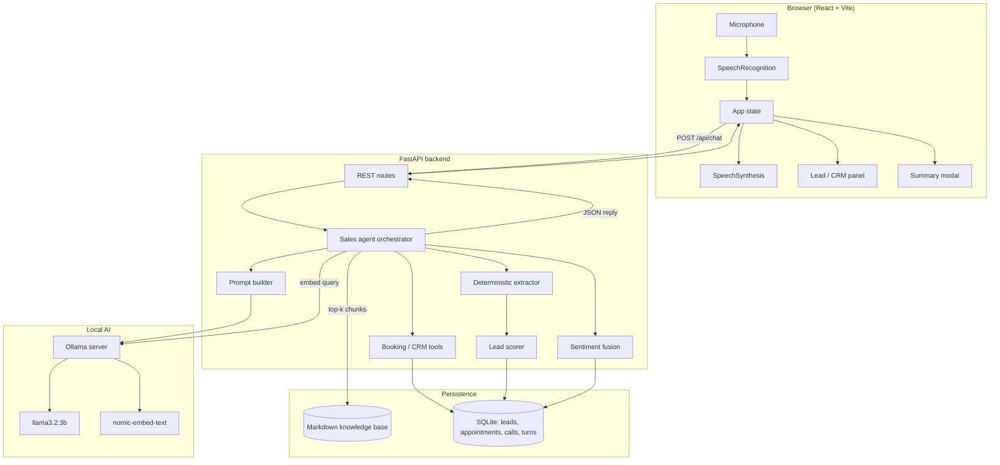
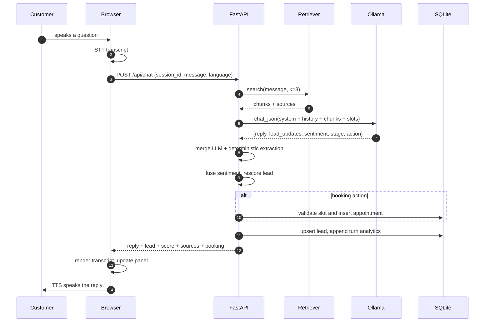
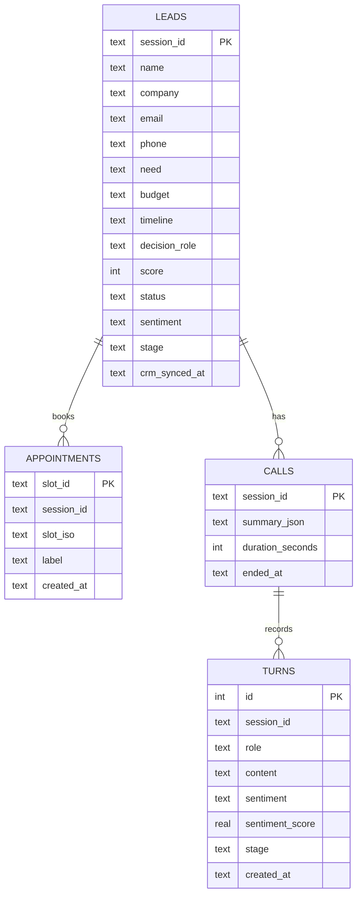
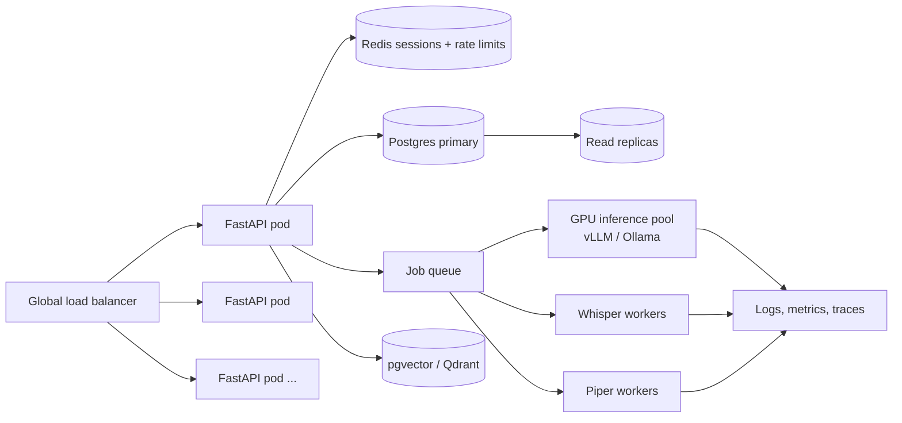

# System Architecture

## 1. Context

The agent is the first-line seller for inbound and outbound sales calls. It must answer product questions accurately, qualify the lead, handle objections, book a meeting, update the CRM and produce a summary a human can act on. The MVP runs entirely on a laptop with free software; every component has a documented production replacement.

## 2. Component diagram

## 3. Turn lifecycle

## 4. Retrieval design

1. Documents in `data/knowledge/` are split on Markdown headings into ~69 chunks with source and heading metadata.
2. If embeddings are enabled, each chunk is embedded once with `nomic-embed-text` at startup and normalised into a matrix.
3. A query is embedded and compared by cosine similarity. If the best score is below `0.2`, the keyword path runs instead.
4. Keyword search tokenises the query, expands Hindi terms and English synonyms (`cost → pricing price plan`, `integrate → crm calendar`), scores overlap with a heading bonus, and applies an intent-aware source boost so pricing questions prefer `03-pricing.md` and security questions prefer `04-security.md`.
5. Retrieved sources are returned to the UI and injected into the prompt; the prompt forbids inventing facts outside them.

## 5. Reliability around a 3B model

| Risk | Mitigation |
|---|---|
| Malformed JSON | Extraction of the first JSON object, trailing-comma repair, one retry, then scripted fallback |
| Missed lead facts | Deterministic regex extraction for email, phone, name, company, budget, timeline, role |
| Wrong pricing | Explicit prompt rule to quote the knowledge-base plans; pricing document boosted in retrieval |
| Stuck in greeting | Monotonic stage advancement based on captured fields and booking state |
| Tone under-read | LLM sentiment fused with a transparent positive/negative lexicon |
| Double booking | Slot re-validation inside a transaction; unique constraint on slot time |
| Model offline | Scripted conversational fallback keeps the demo usable |

## 6. Data model

## 7. Scaling to 1,00,000 users

- **Stateless API:** sessions in Redis; any pod can serve any turn.
- **Inference pool:** separate GPU workers with continuous batching; autoscale on queue depth and p95 latency.
- **Voice workers:** Whisper and Piper scale independently of the LLM.
- **Data:** Postgres with read replicas for CRM reads; vector store partitioned by tenant.
- **Capacity model:** 1,00,000 registered users ≈ 1% peak concurrency = 1,000 simultaneous calls. At ~30 seconds of model work per turn and batching across replicas, 20–40 GPU replicas cover peak with headroom; off-peak scales down.
- **Cost levers:** cache frequent answers, route simple intents to a smaller model, cap turn length, and batch embedding jobs.

## 8. Security and privacy

- **Data minimisation:** only sales-relevant fields; no raw audio stored by the MVP.
- **Transport and storage:** TLS in production; encryption at rest for Postgres, object storage and backups.
- **Tenancy:** tenant ID on every row, enforced at the query layer, with per-tenant API keys.
- **Secrets:** environment variables locally, managed secret store in production; never committed.
- **Compliance:** consent before recording, configurable retention, deletion workflow, audit logs; DPDP (India) and GDPR (EU) considerations documented in the report.
- **Model safety:** prompt-injection defence by treating retrieved text as data, not instructions; output constrained to JSON; no tool execution outside the fixed booking/CRM set.
- **Abuse:** rate limits, payload size limits, and a kill switch for demo reset.

## 9. Deployment

| Environment | Topology |
|---|---|
| Local demo | `uvicorn` + Vite dev server + local Ollama |
| Staging | Docker Compose: API, Postgres, Redis, Ollama, reverse proxy |
| Production | CDN for React build, containers on Kubernetes/ECS, managed Postgres + Redis, private GPU subnet, autoscaling inference, centralised observability |

CI runs backend tests, a frontend build, dependency and image scanning, and a smoke test of `/api/health` before deployment. Blue/green rollout with health checks avoids dropping live calls.

## 10. Failure modes

| Failure | Behaviour |
|---|---|
| Ollama unreachable | Health shows `reachable: false`; chat uses scripted fallback |
| Embedding model missing | RAG automatically degrades to keyword search |
| Slot taken during call | Booking rejected, agent offers another slot |
| LLM returns invalid JSON | Repair, retry, then fallback |
| Frontend cannot reach API | Inline error banner with retry guidance |
| Browser lacks speech support | Text composer remains fully functional |
